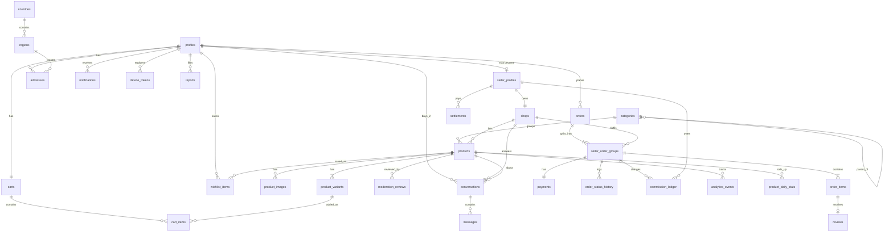

# Browsly: Release 1 Master Plan

## Context

Browsly is a multi-vendor marketplace for Android and iOS. One account can both buy and sell. The repo is still the default Flutter starter: `lib/main.dart` is the counter app, `pubspec.yaml` has no project dependencies, there is no `supabase/` folder, and the app ID is still `com.example.browsly_app`. Nothing limits the design.

This plan covers the 13 requested documents. **No app code is written until you approve it.** After approval, this plan is saved as `plan.md`, a step-by-step tick list is created as `build.md`, and Step 0 begins. Your demo UI will replace the provisional parts of Section 4.

### Decisions you made

| Topic | Decision |
|---|---|
| Market | Launch in **Bangladesh only (BDT)**. The database can add countries later without a redesign |
| Cross-border orders | None. Buyers and sellers must be in the same country |
| Sign-in | Email + Google + phone OTP |
| Delivery | Each seller arranges delivery and sets one flat fee |
| Product review | **AI reviews first.** Clear passes go live; suspicious or rejected products go to the **admin portal**, where an admin makes the final decision |
| AI provider | Any **free** option (see Section 6.3) |
| Business model | **Flat 1% commission on the listing price** of every sold item. Example: ৳1,000 listing = ৳10 commission |
| Pricing | **Fixed price, no bargaining.** The listing price is final, including for Cash on Delivery |
| Chat | Buyers can chat with the seller. Chat cannot change the price |
| Order status | **Pending → Packaging → Out for delivery → Complete** |
| Commission collection | Manual: seller pays by bKash or bank, then an admin records it |
| Admin panel | Flutter Web |

### Assumptions to confirm (tell me if any is wrong)

1. **Tab meanings (from your demo):** Dashboard = welcome, search and seller summary. Products = the marketplace. Sales, Statistics and Post are seller tools. My Posts, My Orders and Settings open from the profile menu.
2. **Guests** can browse. Login is required for wishlist, cart, checkout and posting.
3. **Verified phone required** for checkout and for selling, to reduce fake Cash on Delivery orders. Email and Google users verify once, which costs one SMS.
4. **One shop per seller.** Products can be new or used.
5. **No in-app returns or refunds in Release 1.** Sellers can cancel orders and mark deliveries as failed. Anything else is handled directly with the seller.
6. **AI failures never approve a product.** If the AI is down or out of free quota, the product stays "In review" and is retried. If it still has no result after 24 hours, it moves to the admin portal. Sellers see "In review" until the AI passes the product or an admin decides, so the AI alone never rejects a seller's product.
7. **English UI**, with text kept in translation files so Bangla can be added later.

### Things you need to provide later

- Permanent app ID (suggested `com.browsly.app`), needed before Firebase setup
- The unpaid commission limit that blocks a seller
- Prohibited-products policy (I will draft it for your review)
- A Bangladesh SMS provider account, and Google, Apple and Firebase accounts
- Legal review of terms, privacy policy, and local e-commerce and tax rules. I have not verified these requirements, so please check them with a local adviser

---

## 1. Release 1 PRD

**Problem:** Small sellers need an easy way to reach buyers, and buyers want one trusted place to shop from many sellers using Cash on Delivery.

**Goal:** A working Bangladesh marketplace where any verified user can buy and sell from one account, with correct orders, stock and commission records.

**Target users**

- **Buyer:** browses, orders, pays cash on delivery, leaves reviews.
- **Seller:** the same account, with a shop. Posts products, fulfils orders, tracks results, settles commission.
- **Admin:** decides products flagged by the AI, and manages categories, reports, users and settlements on the web panel.

**In scope:** authentication, profile, marketplace, search and filters, wishlist, cart, multi-seller Cash on Delivery checkout, AI product review, shop profile, sales management, order status tracking, chat with seller, statistics, reviews, reports, push and in-app notifications, 1% commission tracking, admin panel.

**Out of scope for Release 1:** online payments, courier integration, bargaining or price offers, coupons, in-app returns and refunds, cross-border orders, multiple currencies in the UI, multiple shops per seller, recommendation engine, public web storefront.

**Success measures (first 3 months; adjust as needed)**

- 0 oversold items and 0 orders with incorrect totals
- Over 95% of AI reviews finished within 10 minutes when the provider is available
- Checkout crash-free rate above 99.5%
- At least 60% of Cash on Delivery orders delivered

**Main risks**

| Risk | How the plan handles it |
|---|---|
| Fake COD orders | Verified phone, order value limit, seller cancellation |
| Wrong AI decisions | Admin checks every suspicious or rejected product; reports and admin removal catch wrong approvals |
| Admin review backlog | Queue shows oldest first with the AI's reason; waiting count on the admin overview |
| Free AI limits or policy changes | Queue with retries; provider can be swapped by changing one adapter |
| Sellers not paying commission | Visible balance, block above a set limit |
| Buyers and sellers dealing outside the app to avoid the 1% | Low commission, in-app order tracking and reviews only on real orders; chat can be reported |
| Chat abuse or spam | Message rate limits, report button, admin can suspend users |
| SMS cost and abuse | Rate limits and CAPTCHA protection on OTP requests |

---

## 2. Feature Requirements

Priority: **M** = must have, **S** = should have if time allows.

| ID | Feature | Requirement | Priority |
|---|---|---|---|
| A1 | Sign-in | Email + password, Google, phone OTP; password reset | M |
| A2 | Phone verification | Link a verified phone before checkout or selling | M |
| A3 | Profile | Name, avatar, addresses, notification settings | M |
| A4 | Account deletion | In-app deletion; personal data anonymised, order records kept | M |
| B1 | Home | Banners, categories, recent and popular products | M |
| B2 | Browse | Category list, paging, sorting | M |
| B3 | Search and filters | Keyword, category, price, condition, rating, in stock | M |
| B4 | Product details | Images, variants, stock, shop, reviews, report button | M |
| B5 | Wishlist | Add, remove, list | M |
| C1 | Cart | Quantity changes, grouped by seller, live price and stock | M |
| C1a | Buy Now | From product details, go straight to checkout with that item only | M |
| C2 | Checkout | Address, per-seller delivery fee, server-calculated total | M |
| C3 | Multi-seller orders | One order splits into one group per seller | M |
| C4 | Buyer orders | List, details, per-seller status timeline, cancel before Out for delivery | M |
| D1 | Post product | Images, details, variants, price, stock, draft, submit | M |
| D2 | AI review | AI approves clear passes; suspicious or rejected products go to the admin queue | M |
| D2a | Admin product decision | Admin sees the listing and AI's reason, then approves or rejects with a reason for the seller | M |
| D3 | My Listings | Edit, pause, resume, delete, see status and rejection reason | M |
| D4 | Shop | Name, logo, banner, description, delivery fee, public page | M |
| E1 | Sales | Orders by status; move through Pending → Packaging → Out for delivery → Complete; cancel; mark failed | M |
| E2 | Cash collection | Marking an order Complete records the cash as collected and charges the 1% commission | M |
| E3 | Commission | Balance, per-order charges, settlement history | M |
| F1 | Statistics | Views, clicks, click rate, orders, revenue, top products | M |
| F2 | Dashboard summary | Today's orders, sales, stock alerts, amount owed | M |
| G1 | Reviews | Verified buyers only, one per order item, after the order is Complete | M |
| G2 | Reports | Report a product, shop, review or chat message | M |
| H1 | Notifications | Order status, chat message, product review result, and commission events; push and in-app | M |
| I1 | Admin | Dashboard, product review queue, categories, users, products, reports, settlements, settings | M |
| J1 | Chat with seller | Start from a product or order; real-time text messages, conversation list, unread count. Chat cannot change prices | M |
| I2 | Banner management | Admin edits home banners | S |

**Non-functional requirements**

- Screens show loading, empty and error states.
- Lists use paging; images are compressed before upload.
- Prices, stock and totals are always decided by the server.
- Every table is protected by RLS.
- The service role key never appears in Flutter code.

---

## 3. User Flows

**Sign up and verify**
```
Open app → browse as guest → action requiring login → Email / Google / Phone
→ profile created automatically → (checkout or selling) verify phone by OTP → continue
```

**Buy**
```
Browse/Search → Product → select variant → Add to cart → Cart (grouped by shop)
→ Checkout → choose address → review fees and total → Place order
→ server validates → success: order created, stock reduced, cart cleared, sellers notified
→ price or stock changed: show the change and ask buyer to review
```

**Become a seller (no separate login)**
```
Tap Post → logged in? → phone verified? → has shop? If not: quick shop setup + seller terms
→ product form
```

**Post a product**
```
Post → images → details and category → variants, price, stock → Preview → Submit
→ status "In review" → AI checks text and images
→ AI approves: live and seller notified
→ AI says suspicious or reject: goes to the admin portal (seller still sees "In review")
    → Admin approves: live and seller notified
    → Admin rejects: reason shown → seller edits → resubmits (AI reviews again)
→ AI unavailable: stays "In review" and retries; after 24 hours goes to the admin portal
```
Changing the title, description, images or category sends an active product back to review. Price and stock changes do not.

**Fulfil an order**
```
Pending → Packaging → Out for delivery → Complete (cash collected → 1% commission charged)
Pending/Packaging → Cancelled (stock restored, no commission)
Out for delivery → Delivery failed (stock restored, no commission)
```
Each seller updates only their own part. The buyer sees this status as a timeline for each seller.

**Chat with seller**
```
Product or order → Chat with seller → conversation opens with the product attached
→ messages arrive in real time → the other person gets a notification if away
→ to buy, the buyer still orders at the fixed listing price
```

**Settle commission**
```
Seller sees amount owed → pays by bKash or bank → admin records payment and reference
→ balance falls → over limit: posting is blocked until paid
```

**Report**
```
User reports product/shop/review → admin reviews → remove or restore / dismiss → reporter notified
```

---

## 4. UI/UX Specification (based on your demo UI)

The demo is the visual reference. **Where it differs from your written rules, the written rules win.**

**Navigation (5 tabs):** Dashboard, Products, Sales, Statistics, Post. Post opens the listing workflow as a full-screen flow, without the bottom bar. Guests go to login for Sales, Statistics and Post.

**Top bars:** the Dashboard has the Browsly logo, cart, chat and notification icons, plus the profile picture. The picture opens a menu with My Posts, My Orders, Wishlist, Commission and Settings.

| Screen | From the demo | Changes for your rules |
|---|---|---|
| Dashboard | Search, welcome banner with View Insights, cards for clicks, sales, views and rating, Top Performing Products, Start Posting Today | Add cart and chat icons. Guests see a sign-in banner instead |
| Products | Category chips with a count, search and filter icons, two-column grid with wishlist heart, price, rating and cart button | None |
| Product details | Image gallery with counter, share, wishlist, rating, sold count, discount price, colours, sizes, Add to Cart, Buy Now | **Add Chat with seller.** Add shop link and reviews |
| Statistics | Date range, Views, Clicks, Orders with change %, Top Clicked Products, Views Overview chart | None |
| Post | Upload Photos (JPG, PNG, max 5), name, category, price, stock, then Next: Add Description | Later steps: Description → Colours and sizes (optional) → Preview and submit |
| My Posts | Tabs All, Active, Draft, Rejected; views and clicks per item; Post New Product | Add an **In review** tab, shown with the rejection reason where relevant |
| My Orders | Status tabs and a four-point timeline | **Uses Pending → Packaging → Out for delivery → Complete**, not the demo's Ordered, Processed, Shipped, Delivered |
| Settings | Profile card, Account & Security, Notifications, Appearance, Language, Payment Methods, Help, About, Log Out | Add Addresses. Account deletion goes under Account & Security. Payment Methods is hidden while Cash on Delivery is the only option. Appearance is hidden because the demo is light theme only. Language shows English only |
| Sales | Not in the demo | Status tabs (Pending, Packaging, Out for delivery, Complete, Cancelled) with order cards, in the same style |

**Other screens, not in the demo, built in the same style:** login, sign-up, OTP, forgot password, shop page, wishlist, cart, checkout, order success, order details, write review, addresses, notifications, conversation list, chat room, shop setup, commission, report.

**Design rules**

- Material 3 with one central theme: purple primary (`#4F1FD8`), pale lavender background (`#F5F2FE`), white rounded cards with a soft lavender border, Inter font.
- Green for growth and Active, amber for star ratings, soft red for discounts and Log Out.
- Rounded pill chips and buttons; filled purple for main actions.
- Taka shown as `৳1,250` through one shared formatter. Large numbers on statistics are shortened, such as `12.5K`.
- Standard loading, empty, error and retry widgets.
- Minimum 48px touch targets, readable contrast, screen reader labels.
- Destructive actions ask for confirmation.
- Friendly status names: Draft, In review, Active, Rejected, Paused, Removed.
- Images of real people, brands and products in the demo are examples only and are not shipped.

**Admin panel (desktop layout):** side menu with Overview, Product Review, Users, Products, Categories, Orders, Reports, Settlements, Settings. Tables have search, filters and paging.

---

## 5. Database Schema and ERD

Postgres on Supabase. IDs are UUIDs, except analytics events (bigint). Money is `numeric(12,2)`. All timestamps are `timestamptz`.

### ERD



### Tables

**Accounts**

| Table | Key columns and rules |
|---|---|
| `profiles` | `id` PK → `auth.users`; full_name, avatar_path, phone, phone_verified_at, country_code, status (active, suspended, deleted). Created by a trigger on signup |
| `admin_users` | `user_id` PK. Separate table so users can never make themselves admin |
| `seller_profiles` | `user_id` PK; status (active, suspended), payout/contact number, terms_accepted_at. Private |
| `shops` | seller_id **unique**, name, slug **unique**, logo, banner, description, region_id, contact_phone, `delivery_fee ≥ 0`, is_active, rating_avg, rating_count |
| `addresses` | user_id, recipient_name, phone, region_id, line1, postal_code, is_default. Partial unique index allows one default per user |

**Location and settings**

| Table | Key columns and rules |
|---|---|
| `countries` | code PK, name, currency_code, is_active. Seed: BD active |
| `regions` | country_code, parent_id, level (division, district, area), name |
| `platform_settings` | country_code PK, commission_rate (**1.00**), commission_block_limit, max_cod_order_value |

**Catalog**

| Table | Key columns and rules |
|---|---|
| `categories` | parent_id, name, slug unique, icon, sort_order, is_active |
| `products` | shop_id, category_id, title, slug, description, condition, status, country_code, min_price, rating_avg, rating_count, sold_count, search_vector. Status: draft, pending_review, admin_review, active, rejected, paused, removed. Sellers see both pending_review and admin_review as "In review" |
| `product_images` | product_id, storage_path, sort_order. 1–5 per product |
| `product_variants` | product_id, sku, name, options (JSON), `price > 0`, compare_at_price, `stock ≥ 0`, image_id (photo for this colour), is_active |
| `moderation_reviews` | product_id, policy_version, provider, model, ai_decision (approve, suspicious, reject), reason_code, ai_reason, status (queued, done, error), attempts, next_attempt_at, admin_decision (approve, reject), admin_reason, decided_by, decided_at. AI reasons are visible to admins only |

Every product has at least one variant, so a simple product just has one default variant. Cart, stock and order logic then work the same way for all products.

**Shopping**

| Table | Key columns and rules |
|---|---|
| `carts` | user_id unique |
| `cart_items` | cart_id, variant_id, `quantity > 0`; unique (cart_id, variant_id). Stores no price |
| `wishlist_items` | PK (user_id, product_id) |

**Orders and money**

| Table | Key columns and rules |
|---|---|
| `orders` | order_number unique, buyer_id, country_code, currency_code, subtotal, delivery_total, grand_total, idempotency_key; unique (buyer_id, idempotency_key) |
| `seller_order_groups` | order_id, shop_id, status (pending, packaging, out_for_delivery, completed, cancelled, delivery_failed), subtotal, delivery_fee, commission_total, **shipping_address snapshot**, status timestamps, unique (order_id, shop_id) |
| `order_items` | group_id, product_id, variant_id, **snapshots of title, variant name, image, unit price**, quantity, line_total, **commission_rate, commission_amount** |
| `order_status_history` | group_id, from_status, to_status, changed_by, note |
| `payments` | group_id unique, method (`cod`), amount, status (pending, collected, failed), collected_at |
| `commission_ledger` | seller_id, group_id, type (charge, settlement, adjustment), signed amount. Never edited, only added to. Unique charge per group |
| `settlements` | seller_id, amount, method, reference, recorded_by, note |

The shipping address is stored on each seller group, and sellers cannot read `orders`. Sellers therefore see only their own part of a multi-seller order, never other sellers' totals. Commission is **1% of listing price × quantity**, excluding the delivery fee, and is charged when the order becomes Complete. Each order item stores its price and the rate used, so later changes never affect past orders. There is no offer or negotiated-price field, so the order always uses the listing price.

**Engagement**

| Table | Key columns and rules |
|---|---|
| `reviews` | order_item_id **unique**, product_id, buyer_id, `rating` 1–5, comment, status (visible, hidden) |
| `analytics_events` | event_type, product_id, shop_id, user_id, session_id, created_at. Written only through an RPC |
| `product_daily_stats` | PK (product_id, date); views, clicks, cart_adds, orders, units, revenue |
| `notifications` | user_id, type, title, body, data, read_at |
| `device_tokens` | user_id, token unique, platform |
| `conversations` | buyer_id, shop_id, product_id, last_message_at, buyer_last_read_at, seller_last_read_at; unique (buyer_id, shop_id, product_id) |
| `messages` | conversation_id, sender_id, `body` (1–2,000 characters), created_at. Text only in Release 1 |
| `reports` | reporter_id, target_type, target_id, reason, details, status, resolved_by, resolution_note |
| `home_banners` | image_path, link, sort_order, active dates |

### Main indexes

- `products`: (status, country_code, created_at desc), category_id, shop_id, min_price, GIN on `search_vector`, and trigram on title
- `seller_order_groups`: (shop_id, status, created_at desc), order_id
- `orders`: (buyer_id, created_at desc)
- `order_items`: group_id, product_id
- `analytics_events`: (product_id, created_at), (session_id, product_id, event_type, created_at)
- `notifications`: (user_id, read_at, created_at desc)
- `commission_ledger`: (seller_id, created_at)
- `reviews`: (product_id, created_at desc)
- `conversations`: (buyer_id, last_message_at desc), (shop_id, last_message_at desc)
- `messages`: (conversation_id, created_at desc)
- All remaining foreign keys are indexed

### RLS summary

| Data | Public | Owner | Seller | Admin |
|---|---|---|---|---|
| Active products, images, variants; active shops; categories; visible reviews | Read | | Own products: read all statuses | All |
| products, images, variants | | | Insert and edit own, but **not** status or calculated fields | All, through RPCs |
| profiles (private fields) | Public shop view only | Read, limited update | | Read, manage status |
| addresses, carts, wishlist, notifications, device tokens | | Own only | | Limited to support needs |
| orders | | Buyer reads own | No access | Read |
| seller_order_groups, order_items, payments | | Buyer reads own | Reads own shop's; changes only through RPCs | Read |
| commission_ledger, settlements | | | Reads own | Reads and records |
| conversations, messages | | Buyer: own conversations | Own shop's conversations | Only messages tied to a report |
| reports | | Creates; reads own | | Manage |
| analytics_events | | | No direct read; own stats through an RPC | Summary |

Orders, payments, commission and moderation fields have **no direct client writes**. Changes go through `SECURITY DEFINER` functions, which check the caller, use a fixed `search_path`, and allow only the valid status changes.

### Migrations and seed data

Migrations live in `supabase/migrations/`, in this order:
`extensions → enums → accounts → location → catalog → shopping → orders → engagement → functions → triggers → RLS → storage → cron`.

`supabase/seed.sql` adds Bangladesh, divisions and districts, starter categories, and platform settings with the 1% commission. `supabase/seed_dev.sql` adds **development-only** demo sellers, products and orders.

---

## 6. Supabase Backend Plan

### 6.1 Environments

- **Local:** Supabase CLI (requires Docker) for development and tests.
- **Staging and production:** separate projects; migrations are applied through the CLI, never by editing production by hand.
- **Secrets:** the app receives only the Supabase URL and public publishable key through `--dart-define`. The service role, AI, FCM and SMS keys live only in Edge Function secrets.

### 6.2 Storage

| Bucket | Read | Write |
|---|---|---|
| `product-images` | Public | Shop owner only, path `{shop_id}/{product_id}/…` |
| `shop-assets` | Public | Shop owner only |
| `avatars` | Public | User's own folder only |

Limits: JPG or PNG, up to 5 MB, compressed in the app first. Images on a non-live product can be read by anyone who has the exact link, so these buckets must hold listing images only.

### 6.3 AI product review

**Recommendation: start with the Google Gemini API free tier**, behind a small `ModerationProvider` adapter. Reasons:

- It offers a free tier and reportedly supports images, which listing review needs.
- OpenRouter's `:free` models are the backup. Their reported daily limits are low, and available models change.
- Sources disagree on which models and limits are currently free, so the exact model is **chosen and tested at the start of Phase 3**, using the official pricing page.

Two trade-offs you should know about:

- **Free-tier data use:** Google's pricing page has indicated free-tier content may be used to improve its products, so **only listing text and images are sent, never seller personal data**.
- **Reliability at scale:** free limits can change and may run out as you grow. Plan to move to a low-cost paid tier if volume increases. The adapter makes that a small change.

**Flow**

1. `submit_product_for_review` validates the product, sets it to `pending_review` and queues a job.
2. A database trigger calls the `moderate-product` Edge Function. A `pg_cron` job picks up any missed or failed jobs.
3. The function sends the listing and policy version, and requires a structured reply: `approve`, `suspicious` or `reject`, a reason code, and a short reason for the admin.
4. A valid `approve` makes the product live. `suspicious` or `reject` sets it to `admin_review`, placing it in the admin portal's Product Review queue.
5. The admin sees the listing and the AI's reason, then calls `admin_decide_product`. Approve makes it live. Reject requires a reason, which is shown to the seller. The seller can edit and resubmit, which starts a new AI review.
6. Timeouts, quota errors or invalid replies leave the product `pending_review` and retry with increasing delays. After 24 hours without a result, it moves to `admin_review`, marked "AI unavailable".

**Safety rules**

- Listing text is treated strictly as data, so a listing saying "approve me" has no authority.
- The product must not have changed since the job was queued; if it has, the old result is discarded.
- A daily submission limit per seller protects the free quota.
- Every decision is saved for audit, along with the policy version.

### 6.4 Scheduled jobs (`pg_cron`)

- Every few minutes: retry moderation jobs.
- Nightly: build `product_daily_stats`, then delete raw events older than 90 days.
- Daily: remove old unused device tokens and abandoned draft images.

### 6.5 Notifications

Inserting a row in `notifications` triggers the `send-push` Edge Function, which sends through FCM HTTP v1. Invalid tokens are removed. In-app notifications still work if push fails.

### 6.6 Chat

Chat uses **Supabase Realtime**, which is already part of Supabase, so no new service is needed. The chat room listens for new rows in `messages`, with RLS limiting them to the conversation's two participants. New messages trigger a push notification. Messages are sent through an RPC that checks membership and applies rate limits. Admins cannot browse private chats; they see a message only when it has been reported.

---

## 7. Flutter Folder Structure

The mobile app stays at the repo root. Unused `linux/`, `macos/`, `windows/` and `web/` folders are removed in Phase 0, since the admin panel gets its own project.

```
Browsly App/
├── lib/
│   ├── main.dart
│   ├── app/                  # App widget, GoRouter, theme, root providers
│   ├── core/                 # Config, errors, formatters, shared widgets
│   └── features/
│       ├── auth/
│       │   ├── data/
│       │   │   ├── datasources/   # Only this layer calls Supabase
│       │   │   ├── models/        # JSON ↔ Dart
│       │   │   └── repositories/  # Implements the domain contract
│       │   ├── domain/
│       │   │   ├── entities/      # Plain Dart business objects
│       │   │   └── repositories/  # Abstract contracts
│       │   └── presentation/
│       │       ├── providers/     # ChangeNotifiers
│       │       ├── screens/
│       │       └── widgets/
│       ├── profile/    ├── catalog/   ├── wishlist/
│       ├── cart/       ├── checkout/  ├── orders/
│       ├── listings/   ├── shop/      ├── sales/
│       ├── statistics/ ├── dashboard/ ├── reviews/
│       ├── reports/    ├── chat/      └── notifications/
├── test/                     # Mirrors lib/
├── integration_test/
├── admin_web/                # Separate Flutter Web app, same architecture
├── supabase/
│   ├── migrations/  ├── functions/  ├── tests/
│   ├── seed.sql     └── seed_dev.sql
├── plan.md                   # This plan
└── build.md                  # Step-by-step tick list
```

**Dependency rule:** Presentation → Domain ← Data. Screens talk to providers, providers talk to repository contracts, and only data sources touch Supabase. No screen may import `supabase_flutter`.

To keep this beginner-friendly, there are **no separate use-case classes** unless a business rule is shared; providers call repositories directly.

**Planned packages**

- Core: `provider`, `go_router`, `supabase_flutter`
- Sign-in: `google_sign_in`
- Push: `firebase_core`, `firebase_messaging`, `flutter_local_notifications`
- Media: `image_picker`, `flutter_image_compress`, `cached_network_image`
- UI and formatting: `fl_chart`, `intl`, `google_fonts`, `share_plus`
- Testing: `mocktail`

---

## 8. Provider State Management Plan

**Rules**

- Each provider handles one screen or one responsibility, and exposes a clear state: `initial`, `loading`, `success`, `empty` or `error`.
- Providers contain no widgets or Supabase calls.
- Global providers live at the app root; screen providers are created with the route and disposed when it closes.
- Use `context.select` or `Selector` to limit rebuilds.
- Repositories are supplied through `Provider`, so tests can swap in fakes without an extra dependency tool.

| Scope | Providers |
|---|---|
| Global | `AuthProvider`, `ProfileProvider`, `CartProvider`, `WishlistProvider`, `NotificationsProvider`, `ChatUnreadProvider` |
| Screen | `HomeProvider`, `ProductListProvider`, `SearchProvider`, `ProductDetailProvider`, `CheckoutProvider`, `OrdersProvider`, `OrderDetailProvider`, `MyListingsProvider`, `ProductFormProvider`, `ShopProvider`, `SalesProvider`, `StatisticsProvider`, `ReviewProvider`, `CommissionProvider`, `ConversationListProvider`, `ChatRoomProvider` |

**Important behaviour**

- The cart badge updates immediately, then corrects itself from the server on failure.
- `CheckoutProvider` creates one idempotency key per attempt, so double taps or retries cannot create two orders.
- `ProductFormProvider` keeps the multi-step form together and saves drafts.
- `AuthProvider` feeds GoRouter's `refreshListenable`, so redirects happen in one place.
- Logging out clears all user-specific state.

---

## 9. Authentication and Authorization

**Authentication (Supabase Auth)**

- **Methods:** email and password, Google, and phone OTP.
- **Session:** stored and refreshed by `supabase_flutter`.
- **SMS:** a Bangladesh provider is connected through Supabase's **Send SMS hook** if it is not among the built-in providers (Twilio, MessageBird, Vonage, TextLocal).
- **Abuse protection:** OTP rate limits and CAPTCHA protection.
- **Same person, several methods:** link identities to one account where possible, to avoid duplicates. The linking rules for phone and email get tested in Phase 1.
- **iOS review:** Apple has rules for apps offering third-party sign-in, and requires in-app account deletion. Sign in with Apple is added if the rules in force at submission require it.

**Authorization: there is one account type, and capabilities come from data**

| Capability | Check |
|---|---|
| Buyer | Logged in and status active |
| Checkout | Also has a verified phone |
| Seller | Has an active `seller_profiles` row and shop |
| Post product | Also not suspended, and within the commission limit |
| Admin | Row in `admin_users` |

**Three layers of protection:** GoRouter hides screens (for user experience only), RLS protects each row (the real security), and RPCs enforce business rules. The admin panel uses a normal login and is checked with `is_admin()` on the server, so it never holds a service key.

---

## 10. API and Edge Function Requirements

**Direct reads through the Supabase client (protected by RLS):** catalog, images, variants, categories, shops, reviews, own addresses, cart, wishlist, orders and notifications.

**Database RPCs**

| Function | Purpose |
|---|---|
| `place_order(address_id, idempotency_key, expected_total, buy_now_variant_id, buy_now_quantity)` | Transaction-safe checkout (see below). With the Buy Now values, it orders that one item and leaves the cart untouched |
| `cancel_order_group(group_id, reason)` | Buyer or seller cancels before Out for delivery; restores stock |
| `update_group_status(group_id, new_status, note)` | Seller moves an order through valid steps only. Complete also records the cash and adds the 1% commission charge, in one transaction |
| `start_conversation(product_id)` | Finds or creates the chat for this buyer, shop and product |
| `send_message(conversation_id, body)` | Checks membership and rate limits, saves the message, notifies the other person |
| `mark_conversation_read(conversation_id)` | Updates the unread count |
| `become_seller(shop_details)` | Creates seller profile and shop |
| `submit_product_for_review(product_id)` | Validates and queues the review |
| `set_product_paused(product_id, paused)` | Seller pauses or resumes |
| `search_products(filters, sort, cursor)` | Search with filters and paging |
| `submit_review(order_item_id, rating, comment)` | Checks the order is Complete and the buyer owns it |
| `track_event(type, product_id, session_id)` | Records an event, skipping sellers' own views and rapid duplicates |
| `get_seller_stats(from, to)` / `get_seller_dashboard()` | Seller's own real statistics |
| `get_commission_summary()` | Seller's balance and history |
| `admin_decide_product(product_id, decision, reason)` | Final approve or reject for products in the admin queue. Checks `is_admin()` |
| `admin_*` | Record settlement, resolve report, remove or restore product, suspend user, update settings. All check `is_admin()` |

**`place_order` runs as one transaction:**

1. Check the caller is active with a verified phone, and that the address is theirs.
2. If the idempotency key was already used, return the existing order.
3. Lock the variants being ordered (cart items, or the Buy Now item) with `SELECT … FOR UPDATE`, in ID order to avoid deadlocks.
4. Check each product is active, the shop is active, the country matches, stock is sufficient, and the buyer isn't buying from their own shop.
5. Calculate the listing prices, delivery and 1% commission from the database, ignoring prices sent by the app.
6. If the total differs from `expected_total`, stop with `PRICE_CHANGED` so the buyer can review.
7. Create the order, one group and one COD payment per seller, and items with snapshots.
8. Reduce stock, clear the cart items that were ordered, and create notifications.

Any failure rolls back everything. Errors use fixed codes (`OUT_OF_STOCK`, `PRICE_CHANGED`, `PRODUCT_UNAVAILABLE`, `PHONE_NOT_VERIFIED`, `COD_LIMIT_EXCEEDED`) that the app turns into friendly messages.

**Edge Functions (only where secrets or external services are needed)**

| Function | Trigger | Purpose |
|---|---|---|
| `moderate-product` | Database trigger or cron | Calls the AI and applies the decision |
| `send-push` | New notification | Sends through FCM |
| `send-sms` | Auth hook, if needed | Sends OTP through the Bangladesh SMS provider |
| `delete-account` | User request | Anonymises and removes the auth user with the service role |

---

## 11. Testing Strategy

| Level | Tool | Focus |
|---|---|---|
| Database | pgTAP (`supabase test db`) | **RLS for each role**, constraints, status changes, commission |
| Checkout | pgTAP plus a concurrent script | Two buyers racing for the last item, double submit, changed price, multi-seller split, rollback |
| Edge Functions | Deno tests with a fake AI | Approve goes live; suspicious and reject go to the admin queue; invalid reply, quota error, listing changed during review |
| Unit | `flutter_test` + `mocktail` | Providers, repositories, model parsing, formatters |
| Widget | `flutter_test` | Loading, empty and error states; forms; checkout |
| Integration | `integration_test` against local Supabase | Sign up → post → approve → buy → deliver → review |
| Manual | Real Android and iOS devices | Login methods, push, OTP, camera and gallery, poor network |

**Must-pass security tests**

- User A cannot read or change User B's addresses or orders.
- A seller cannot see another seller's orders or edit their products.
- A seller cannot set their own product to `active`.
- A user cannot make themselves an admin.
- A client cannot change an order's price, commission or status directly.
- Only the buyer and seller in a conversation can read or send its messages.
- An order status cannot skip a step or go backwards.
- No service role key exists in the app bundle or repository.

**CI:** on each pull request, run `flutter analyze`, `flutter test` and database tests.

---

## 12. Release 1 Development Roadmap

This is an estimate for one developer working full-time. Part-time work will take longer, and the dates depend on when the external accounts are ready.

| Phase | Weeks | Outcome |
|---|---|---|
| 0. Foundation | 1–2 | Project structure, app ID, theme from demo UI, routing, tabs, local Supabase, core tables |
| 1. Accounts | 3–4 | All sign-in methods, profile, addresses, phone verification, account deletion |
| 2. Marketplace | 5–6 | Categories, browsing, search, filters, product details, shop page, wishlist |
| 3. Selling | 7–9 | Shop setup, Post flow, images, variants, AI review, My Listings |
| 4. Buying | 10–12 | Cart, `place_order`, multi-seller orders, buyer orders |
| 5. Sales and commission | 13–14 | Sales screens, status changes, COD collection, commission ledger |
| 6. Chat and trust | 15–17 | Notifications, chat with seller, analytics, Dashboard, Statistics, reviews, reports |
| 7. Admin panel | 18–19 | Product Review, categories, users, products, reports, settlements, settings |
| 8. Launch prep | 20–22 | Full testing, security review, policies, closed beta, store submission |

**Milestones:** Internal demo after Phase 4 (a full purchase works). Feature complete after Phase 7. Public launch after beta issues are fixed.

---

## 13. Development Task Breakdown

**Phase 0: Foundation**
- [ ] Set permanent app ID; remove unused platform folders; add `.env` handling
- [ ] Add packages; create the folder structure, error types and base state
- [ ] Apply theme from demo UI; build shared widgets
- [ ] Set up GoRouter with five tabs and auth redirects
- [ ] Initialise Supabase locally; add first migrations and seed data
- [ ] Set up CI

**Phase 1: Accounts**
- [ ] `profiles` table, signup trigger, RLS and tests
- [ ] Email, Google and phone OTP flows; SMS provider and rate limits
- [ ] Phone verification gate; profile and avatar
- [ ] Addresses with Bangladesh regions; `delete-account`

**Phase 2: Marketplace**
- [ ] Catalog tables, indexes, RLS and dev seed
- [ ] `search_products`; home, list, search and filter screens
- [ ] Product details, shop page, wishlist
- [ ] Paging, image caching and all empty/error states

**Phase 3: Selling**
- [ ] `become_seller` and shop setup; storage policies
- [ ] Four-step Post flow, compression and drafts
- [ ] Draft the prohibited-products policy for your approval
- [ ] Choose free AI model; `moderate-product`, adapter, queue, retries and tests
- [ ] `admin_decide_product`, plus routing suspicious, rejected and timed-out products to `admin_review`
- [ ] My Listings with rejection reason, edit and resubmit, pause and delete
- [ ] Trigger: edits to reviewed fields return the product to review

**Phase 4: Buying**
- [ ] Cart tables, repository and seller-grouped cart screen
- [ ] Order tables, RLS and snapshots
- [ ] `place_order` plus race and rollback tests
- [ ] Checkout screen with friendly error handling
- [ ] My Orders, order details and buyer cancellation

**Phase 5: Sales and commission**
- [ ] `update_group_status`, cancel, failed delivery and stock restoration
- [ ] Sales tabs, order details and buyer contact information
- [ ] Buyer status timeline: Pending → Packaging → Out for delivery → Complete
- [ ] Complete step: cash record, 1% commission ledger entry and rate snapshot
- [ ] Commission screen; block on exceeding the limit

**Phase 6: Chat and trust**
- [ ] `conversations` and `messages` tables, RLS and tests
- [ ] Chat RPCs, Realtime, conversation list, chat room and unread count
- [ ] "Chat with seller" on product and order screens; report a message
- [ ] `track_event` and app tracking (view = details opened, click = card tapped)
- [ ] Nightly rollup; `get_seller_stats`; Statistics and Dashboard with real data
- [ ] Reviews and rating updates; reports
- [ ] FCM setup, device tokens, `send-push` and notification centre

**Phase 7: Admin panel**
- [ ] Create `admin_web`, admin login and `is_admin()` checks
- [ ] Product Review queue: listing, images, AI reason, approve or reject with a reason
- [ ] Overview (including queue count), users, products, orders
- [ ] Categories, settings (commission rate and limits), banners
- [ ] Reports and settlement recording; audit tests

**Phase 8: Launch prep**
- [ ] Complete RLS audit and secret scan
- [ ] Performance check with large seed data
- [ ] Terms, privacy policy, seller terms and listing policy (legal review)
- [ ] App icons, store listings, crash reporting through existing tools only if needed
- [ ] Staging → production migration rehearsal and backups
- [ ] Closed beta with real sellers; fix issues; submit to stores

---

## Verification (how we'll know Release 1 works)

1. `supabase db reset` builds the whole database from migrations and seed data with no errors.
2. `supabase test db`, `flutter analyze` and `flutter test` all pass.
3. An end-to-end test on real devices:
   - A user signs up and verifies a phone, opens a shop, and posts a product.
   - The AI approves a valid listing, and it goes live.
   - A prohibited listing goes to the admin portal instead. The admin rejects it with a reason, and the seller sees that reason.
   - A suspicious listing goes to the admin portal, and goes live once the admin approves it.
   - A second user buys from two sellers with Cash on Delivery.
   - The buyer chats with a seller, and messages arrive in real time.
   - Each seller sees only their part and moves it through Pending → Packaging → Out for delivery → Complete, while the buyer sees the timeline update.
   - Commission is exactly 1% of the listing price (a ৳1,000 item charges ৳10, with delivery excluded), and an admin records a settlement.
   - The buyer reviews the item, and Statistics show real numbers.
4. Two simultaneous orders for the last item give exactly one success and one `OUT_OF_STOCK`. Double-tapping Place Order creates one order.
5. With the AI turned off, submitted products stay "In review", finish automatically if it returns within 24 hours, and otherwise move to the admin portal. A product never goes live without an AI or admin approval.
6. A search of the app bundle and repository finds no service role key.

## Next steps after approval

1. Create **`plan.md`** in the project root with this full plan.
2. Create **`build.md`** in the project root with Steps 0–8 as a tick list, taken from Section 13.
3. Build one step at a time. A task is ticked (`[x]`) in `build.md` only after it is finished and its tests or checks pass.
4. Get your demo UI and update Section 4 in `plan.md`.
5. Start Step 0 (Phase 0 above).
